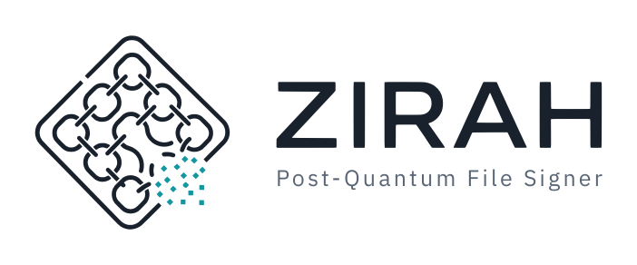
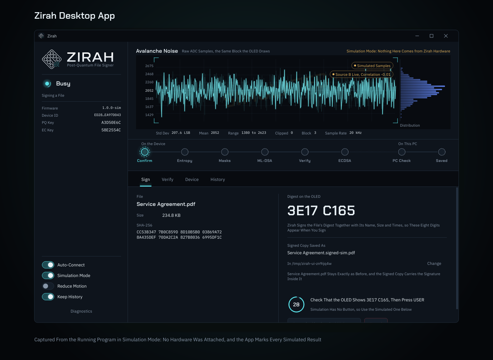
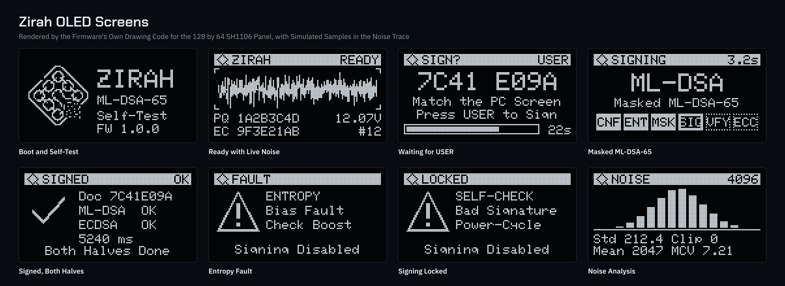

<picture>
  <source media="(prefers-color-scheme: dark)" srcset="docs/assets/banner-dark.png">
  
</picture>

Zirah is a post-quantum hardware signer built around an STM32F407, either the DevEBox STM32F4XX_M core board measured in the technical report or the STM32F4DISCOVERY it was first written for. It began as a home-built avalanche-noise random number generator, a reverse-biased 2N3904 sampled by the STM32 and checked with SP 800-90B health tests, and that noise source still supplies every random bit the device uses. Around it the board makes a post-quantum ML-DSA-65 signature (FIPS 204) with first-order masking of the secret-key multiplications and adds a classical ECDSA P-256 signature from an ATECC608 secure element whose key never leaves that chip. A Windows desktop app and a command-line tool are the device's interface: they hash the file, send the board a digest to sign, show its live noise and every signing stage as the board reports it, and check both signatures before saving anything.

Zirah (زرہ) is the Urdu and Persian word for a coat of mail.

## What Zirah Does

You drop a file onto the Zirah window. The PC hashes it with SHA-256, puts that hash into a short manifest with the file's name, size and times, and sends only the 32-byte digest of the manifest to the board, so the file itself never leaves the computer. The OLED on the board shows the first eight digits of that digest, and nothing is signed until you compare them with the window and press the board's button, K1 on the DevEBox or the blue USER button on the Discovery. The board then runs a fresh health test on its noise source, refreshes the masks on its key, signs, checks its own signature before releasing it, and asks the ATECC608 for the classical half. The PC verifies both halves again with code that shares nothing with the firmware, hashes the file a second time, and only then writes `contract.signed.pdf` next to the original: a copy meant to open like the original, with the signature inside it. File types with nowhere to hide a signature, such as plain text, get a separate `contract.txt.zirah.json` instead. Because the manifest is what the board signs, none of the name, size and times can be changed afterwards either. Anyone holding your exported public keys can verify the file later in Zirah's Verify page, which needs no board, so the people who check your signatures install Zirah and never need the hardware.

## What Zirah Signs

Zirah signs files of any type and any size. The board never sees the file, because the PC streams it through SHA-256 and the board signs a 32-byte digest of a manifest that holds that hash with the file's name, size and times. So a firmware image, a compiled program, a spreadsheet, a photo, a video or a disk image is signed exactly the same way as a contract, and the file type decides only where the signature travels.

| File type | Recognised as | Where the signature goes |
|---|---|---|
| PDF | a `%PDF-` header at the start | inside a signed copy, `name.signed.pdf`, after the original end of the file |
| Word, Excel and PowerPoint (Office Open XML) | a ZIP header and one of the endings `.docx` `.docm` `.dotx` `.dotm` `.xlsx` `.xlsm` `.xltx` `.xltm` `.pptx` `.pptm` `.potx` `.potm` `.ppsx` `.ppsm` | inside a signed copy, as an extra part that nothing in the file points to |
| ZIP archives | a ZIP header and the `.zip` ending | inside a signed copy, in the archive comment |
| PNG images | the PNG signature at the start, whatever the ending | inside a signed copy, in a private chunk before `IEND` |
| JPEG photos | a JPEG start-of-image marker at the start, whatever the ending | inside a signed copy, after the end-of-image marker |
| Every other file: programs and installers (`.exe`, `.msi`, `.dll`), firmware images (`.bin`, `.hex`, `.elf`), source code and scripts, text, CSV and JSON, other image, audio and video formats, disk images, databases, OpenDocument, EPUB, JAR and APK files, older Office files (`.doc`, `.xls`, `.ppt`), password-protected Office files and files with no extension | anything else | a detached signature, `name.ext.zirah.json`, saved next to the file |

A few rules hold for every type:

- The original file is never changed or overwritten. A signed copy is the original with one block added where readers skip it, and removing that block gives back the original bytes exactly, which is what the signature covers.
- Any file can get a detached signature instead of a signed copy, with `zirah sign --detached` or by choosing a `.zirah.json` name in the app.
- A file whose structure leaves no safe place for the block falls back to a detached signature: a PDF without a final `startxref`, a ZIP archive with ZIP64 records, a JPEG with data after its end marker, or a PNG that does not end in `IEND`.
- Only regular files are signed, so a folder or a device is refused, and so are a file that already carries a Zirah signature (sign the original instead) and a file that changes while Zirah reads it.
- Renaming a signed file does not break the signature, and the Verify report shows the name it was signed under. A renamed file's detached signature is no longer found by name, so choose it by hand on the Verify page or pass `--sig`.

A Zirah signature says that these exact bytes were approved on the board that holds the key. It does not make a file safe to open or run, and Windows code signing, PDF readers, Office and bootloaders do not read Zirah signatures. They are checked in Zirah's Verify page or with `zirah verify`, which need no board.

## How Zirah Works

- **Randomness from noise.** A 2N3904 run backwards at about 12 V produces avalanche noise. An LM358 amplifies it, the STM32 samples it 20,000 times a second, checks every symbol with the SP 800-90B repetition and adaptive-proportion tests, and conditions it through SHAKE256. Keys, masks and the hedged signing randomness all come from it. The ATECC608's random generator, the STM32's own, the jitter of the STM32's internal RC oscillator against its crystal clock and the noise in the low bits of the board's accelerometer are mixed in as further inputs credited with no entropy, each only when its check passes, so they can only add to the noise source, never stand in for it. An optional second noise source, built from spare parts on the unused half of the LM358, lets the board check at every start-up test that the two sources do not move together, which catches a signal injected into both.
- **Masking and shuffling.** The secret vectors of the ML-DSA key sit in RAM only as two random shares that add up to the secret, refreshed before every signature, and the two products that touch them are computed one share at a time. Every pass over a share visits the coefficients in a fresh random order, so the moment a given coefficient is handled changes from one signature to the next.
- **Fast transforms.** The device uses the Cortex-M4 assembly NTT from pqm4. A test on an emulated Cortex-M4 shows it gives byte-identical keys and signatures to the reference C code while executing about a quarter of the instructions per transform.
- **Checks on both ends.** The firmware verifies every signature before it lets it out; a signature that fails is withheld and signing locks until a power cycle. The PC verifies again, refuses keys it has not been told to trust, and never overwrites a file.
- **The secure element and its limit.** The ATECC608 protects the ECDSA key in hardware, but it cannot store or compute an ML-DSA key, so the post-quantum key lives in ordinary STM32 flash. Turning on readout protection is part of setting the device up, the app warns with Readout Protection Off until it is, and `docs/DESIGN.md` explains why a secure element on the board does not by itself make the post-quantum key safe.

## Getting Started on Windows

1. Install Python 3.10 or newer from python.org (tick "Add python.exe to PATH"). The Discovery also needs STM32CubeProgrammer from st.com; the DevEBox does not.
2. Double-click `setup.bat`. It installs everything into a private `.venv` folder inside Zirah and adds Zirah to the Start Menu.
3. Wire the breadboards with `hardware/WIRING.md`. On the DevEBox, connect the USB-TTL adapter to PA9 and PA10, power the board over USB-C, put the BT0 wire in and run `flash-devebox.bat`. On the Discovery, plug in the mini-USB cable and run `flash.bat`.
4. Start Zirah from the Start Menu or with `zirah-app.bat`. The DevEBox talks to the PC through the same USB-TTL adapter, and the Discovery through a micro-USB data cable in its CN5 socket.

`docs/GUIDE.md` walks through every step, including setting the boost voltage, provisioning the ATECC608, generating and trusting the key, and readout protection. With no board at hand, switch on Simulation Mode in the app to try the whole workflow; everything it produces is marked simulated and never verifies as a hardware signature.

## What Is in This Folder

| Item | Purpose |
|---|---|
| `setup.bat` | one-time setup: private Python environment, packages, Start Menu shortcut |
| `zirah-app.bat` | starts the desktop app with no console window |
| `zirah.bat` | the command line tool (`zirah status`, `zirah sign file.pdf`, `zirah verify file.pdf`, `zirah bench`, `zirah validate`) |
| `flash-devebox.bat` | writes `firmware/zirah-devebox.bin` onto the DevEBox through the USB-TTL adapter and the STM32's serial bootloader |
| `flash.bat` | writes `firmware/zirah.bin` onto the Discovery through its ST-LINK |
| `zirah-tests.bat` | runs every test suite and prints PASS, FAIL or SKIP for each |
| `ui/` | the desktop app (PySide6) |
| `host/` | the shared host core, the command line tool and the simulated device |
| `firmware/` | the firmware source, the vendored ML-DSA reference code and the prebuilt `zirah-devebox.bin` and `zirah.bin` |
| `hardware/` | parts list, wiring steps, schematic and breadboard drawings |
| `brand/` | the vector logo traced from the official sheet and the script that renders every icon |
| `docs/` | user guide, design and threat model, host protocol, requirements and implementation |
| `tests/` | firmware code tests on the PC, host tests, the app flow test and the style check |
| `scripts/` | flashing, readout protection and shortcut helpers |
| `analysis/`, `data/entropy/` | optional noise capture and plots |

## Hardware

The DevEBox STM32F4XX_M core board (STM32F407VE, 512 KB of flash) or the STM32F4DISCOVERY (STM32F407VG, the same chip with 1 MB), an ATECC608 breakout, a 1.3 inch SH1106 I2C OLED, an MT3608 boost module, a 2N3904, an LM358, and resistors and capacitors on breadboards. The DevEBox also needs a USB-TTL adapter such as a CP2102. The full list is in `hardware/BOM.md`.

| Connection | DevEBox Pin | Discovery Pin |
|---|---|---|
| noise amplifier output | PA4 | PA1 |
| second noise source (optional) | PB1 | PB1 |
| boost voltage monitor | PB0 | PB0 |
| I2C SCL (OLED and ATECC608) | PA8 | PA8 |
| I2C SDA (OLED and ATECC608) | PC9 | PC9 |
| confirmation button (on the board) | K1 on PA0 | USER on PA0 |
| host serial link | PA9 and PA10, to the USB-TTL adapter | micro-USB socket CN5 |
| boost module and LM358 supply | 5V | 5V |
| OLED, ATECC608 and the mid-rail reference | 3V3 | 3V |
| ground | GND | GND |

The DevEBox carries its own LED on PA1, which is why its noise input moved to PA4, and it has no ST-LINK, so the USB-TTL adapter carries both the flashing and the serial link. `hardware/WIRING.md` lists the differences.

## Testing

`zirah-tests.bat` (or `python tests/run_tests.py`) runs ten suites. The firmware's own OLED and ML-DSA code is compiled for the PC: every screen is rendered and fails the run if any text is clipped, and the masked, shuffled signer is checked byte for byte against the pq-crystals reference under AddressSanitizer. The entropy source's health tests and correlation check are driven with synthetic noise. A dudect-style timing test finds no difference between a fixed and a random secret in the key-handling kernels while catching a deliberately leaky compare, and the firmware build is checked for division instructions in that code, since the Cortex-M4 divider is not constant time, and for being byte for byte the `zirah.bin` and `zirah-devebox.bin` that ship. On Linux, the assembly NTT and the whole signer test run on an emulated Cortex-M4 in QEMU. The boot self-test vectors are recomputed with dilithium-py, the host rules (trust, verification, no overwrite, cancellation, a file that changes mid-signing, signed copies in every supported format) have 64 unit tests, and the desktop app is driven through a complete sign and verify flow against the simulated device, started and quit the way `zirah-app.bat` runs it, and timed while its noise trace animates. Suites whose tools are missing on a PC, such as a C compiler on a plain Windows install, report SKIP with the reason rather than passing.

On the board itself, **Run Benchmark** in the Device page (or `zirah bench`) times every stage of the masked signing path over 20 signatures (up to 100 with `zirah bench --count`) with a throwaway key, and compares the cycles of the assembly NTT with the C code on the real chip. `zirah validate` runs every hardware check in one go, the readiness checks, a fresh health test, both noise sources, repeated A-B correlation measurements, an identity proof and the benchmark, and writes the measured numbers into a Markdown and a JSON report for a write-up.

## Measured on the DevEBox

The board described in the technical report is a DevEBox STM32F4XX_M with Board A built as in `hardware/board_a_build.html`. Measured on 5 November 2026:

| Measurement | Result |
|---|---|
| Masked ML-DSA-65 signature, 20 runs, throwaway key | median 157.4 ms, 57.8 to 519.8 ms (1 to 24 rejection attempts) |
| On-device verification | 39.9 ms |
| Whole signing operation with the device key, without the button wait | 0.67 s and 0.76 s for two files |
| Raw noise, 1,000,000 samples at 20 kHz | mean 2052.0, standard deviation 95.5 ADC steps, nothing clipped |
| NIST SP 800-90B non-IID assessment, 8-bit symbols | 6.898 bits per symbol (the firmware credits 1.00) |
| NIST SP 800-90B non-IID assessment, bit 0 | 0.784 bits |
| IID permutation tests | failed 3 of 19 (lag-1 autocorrelation 0.096), so the non-IID result applies |
| Readout protection | level 1, set through the ROM bootloader |

The noise also carries spectral lines at multiples of about 115.6 Hz that hold about 5 % of its variance, whose source has not been identified. `docs/DESIGN.md` has the details and `data/entropy/README.md` the assessment commands.

## Limits

This is a research prototype, not a certified product. Only the secret-key multiplications are masked, so Zirah is not a fully side-channel protected ML-DSA implementation, and the leakage check behind that design was done in an emulator rather than on the real chip. The noise source is checked by its built-in health tests, not certified. ML-DSA-87 does not fit in this chip's RAM. `docs/DESIGN.md` sets out exactly what can and cannot be claimed.

## Citing Zirah

`CITATION.cff` holds the citation for this release. Release 1.0.0 is archived on Zenodo together with the raw captures and NIST outputs behind the measurements, at https://doi.org/10.5281/zenodo.23982873. A technical report on the DevEBox build and its measurements, "Zirah: A Post-Quantum True Random Number Generator Hardware Signer With an Avalanche Noise", is being submitted to arXiv.

## Licence

MIT for Zirah's own code and documentation (`LICENSE`). Third-party parts keep their own licences, listed in `THIRD_PARTY_NOTICES.md`.

Author: Muhammad Shaheer Bin Junaid.
